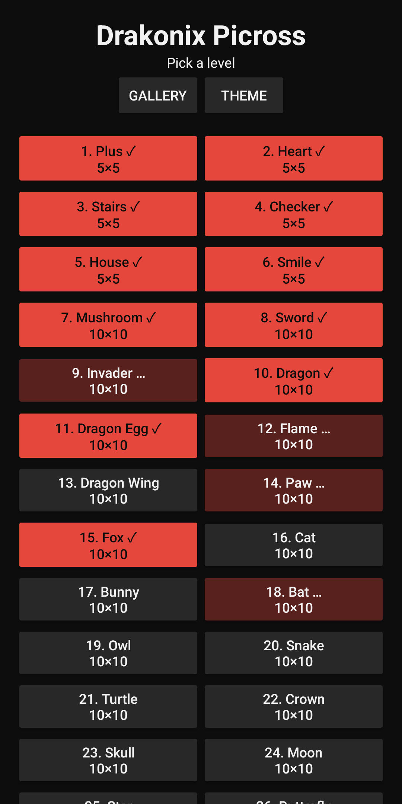
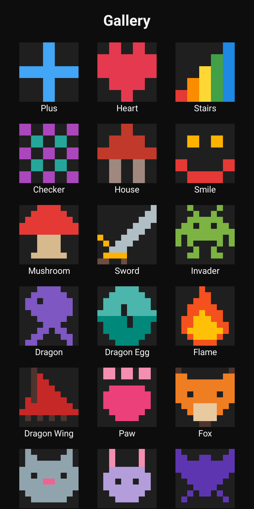
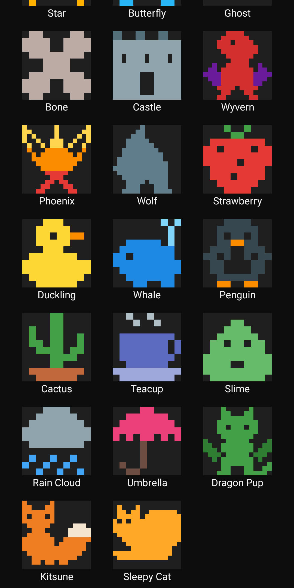

# Drakonix Picross

Simple Android picross (nonogram) game.

**[Download the latest APK](https://github.com/meltingscales/DrakonixPicrossAndroid/releases/latest)**
from the releases page and sideload it. Google Play listing coming soon.





Play Store screenshots (1080×2160) live in [`screenshots/play/`](screenshots/play/).

- 54 levels (6 at 5×5, 39 at 10×10, 9 at 15×15) — dragons, furries, and
  cute critters; pinch to zoom, two fingers to pan
- Color themes inspired by Downwell (Paper, Downwell, Game Boy, CGA, …)
- In-progress puzzles are saved when you leave them
- Self-playing tutorial with step controls (offered on first launch, or Help → Tutorial)
- Optional lives mode (Options): wrong moves cost a life and reveal that cell
- Clue numbers fade individually once their run is correctly placed
- Gallery mode: solved levels show their pixel art, unsolved stay "???"
- Levels are plain ASCII data files: `app/src/main/assets/levels/NN_name.txt`
  (file order = level order). Optional `CHAR=#RRGGBB` lines color the
  picture revealed on solve and in the gallery; `#` uses the theme color:

  ```
  Strawberry
  R=#E53935
  G=#43A047
  ...G..G...
  ....GG....
  .RRRRRRRR.
  ```
- No ads
- Free
- No dependencies beyond the Android SDK — plain Kotlin + custom Canvas view
- Made to test Claude's models
- Made with Fable 5

## Play

Tap **Fill** to paint cells, **Mark ✕** to flag empties. Drag to paint runs.
A puzzle counts as solved when every row/column clue is satisfied.
Solved levels get a ✓ on the level list (saved in SharedPreferences).

## Build

```sh
just run    # build + install + launch on connected device
just build  # APK: app/build/outputs/apk/debug/app-debug.apk
```

`just --list` shows all commands (build, bundle, install, launch, run,
uninstall, clean, screenshot). Without `just`: `./gradlew assembleDebug`.

Requires Android SDK (compileSdk 36) and JDK 17+. Point `local.properties`
at your SDK (`sdk.dir=...`). minSdk 26.

## Install on device

```sh
adb install app/build/outputs/apk/debug/app-debug.apk
```
